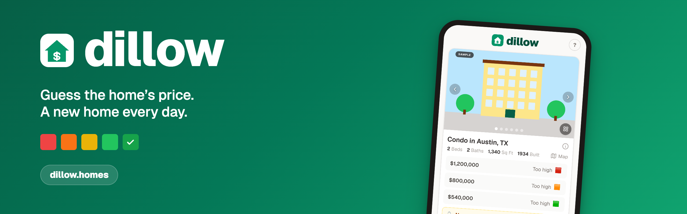
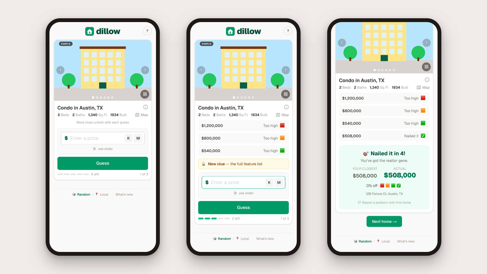

<p align="center">
  <a href="https://dillow.homes/"></a>
</p>

<p align="center">
  <b>a daily home-price guessing game.</b> real us homes, hidden list prices, five tries each.
</p>

<p align="center">
  <a href="https://dillow.homes/"><b>▶ play at dillow.homes</b></a>
  &nbsp;·&nbsp;
  <a href="https://dillow.homes/changelog">what’s new</a>
  &nbsp;·&nbsp;
  <a href="#local-development">run it locally</a>
</p>

<p align="center">
  
</p>

> Screenshots use a placeholder illustration and address. The live game shows
> real listing photos.

---

## How it plays

Every day there are a few new homes. Study the photos, the facts and the map,
then guess what each one is listed for.

- 🎯 **Five tries per home.** Each guess says *higher* or *lower* and how warm you
  are: 🟥 🟧 🟨 🟩 ✅. Land within **0.1%** to nail it.
- 🔓 **Clues unlock as you go.** Lot size and list date after one guess, the
  listing description after two, the full feature list after three.
- 🎚️ **The slider narrows** to the range your guesses have proven.
- 🏆 **Per-home leaderboards**, ranked by closest guess, with fewest tries as the
  tie-break. Plus a daily streak and personal stats.
- 👯 **Challenge rooms.** Share a link and play bonus rounds against friends.
- 📍 **Local mode.** An endless run of homes near you.
- 🗺️ **A real map** (Leaflet + OpenStreetMap), a full photo gallery, and a link
  to the real listing once you finish.

No accounts. Your id is an anonymous UUID in `localStorage`.

## Tech stack

- **[Next.js 16](https://nextjs.org/)** (App Router) · **React 19** ·
  **TypeScript** (strict) · **Tailwind CSS v4**
- **[Upstash Redis](https://upstash.com/)** for game state, leaderboards and
  rooms (optional locally)
- **Leaflet** maps, **`next/og`** for the link-preview images
- Hosted on **Vercel**. Listing data from realtor.com via the
  [realtor16][r16] RapidAPI wrapper, snapshotted into the repo (read
  [Data source and terms](#data-source-and-terms))

## Local development

Needs **Node 20.9+** and npm.

```bash
git clone https://github.com/awlevin/dillow.git
cd dillow
npm install
npm run dev        # http://localhost:3000
```

**No environment variables needed.** The homes come from the committed
snapshot in `src/data/`, so you get the real game. With no Redis, game state
lives in server memory (lost on restart) and the leaderboards, crowd stats and
challenge rooms switch off.

To turn those on, copy the template and add Upstash credentials:

```bash
cp .env.example .env.local
```

Before you open a PR:

```bash
npm run lint
npm run typecheck
npm run build
```

CI runs the same three on every pull request.

---

## Contents

- [Data source and terms](#data-source-and-terms) ← read before forking
- [The request budget](#the-request-budget)
- [Architecture](#architecture)
- [Environment variables](#environment-variables)
- [Common workflows](#common-workflows)
- [Conventions and gotchas](#conventions-and-gotchas)
- [Contributing, security, license](#contributing-security-license)

---

## Data source and terms

**Read this before you fork this repo, and before you point it at any data
source of your own.**

The listing content — addresses, prices, descriptions, and photo URLs — comes
from **realtor.com**, reached through **[realtor16][r16]**, a third-party
community wrapper on RapidAPI. realtor16 is *not* an official realtor.com API
and Move, Inc. does not license it. Photos are served straight from
realtor.com's `rdcpix` CDN (hotlinked, never copied into this repo).

What that means in practice:

- **The MIT license in [LICENSE](LICENSE) covers the source code only.** It
  does not and cannot cover the contents of `src/data/pool.json` and
  `src/data/enrichment.json`. Listing descriptions are written by listing
  agents and brokers and are their copyright; the photos are the copyright of
  whoever shot them. None of it is the maintainer's to relicense.
- **Do not treat `src/data/` as reusable open data.** It is committed so the
  game has content and so gameplay never touches the network — not as a
  dataset release. If you fork this for anything beyond running it locally,
  regenerate it from a source you have rights to.
- **The legitimate path is IDX.** A licensed broker or agent signs an IDX
  agreement with their MLS, which gets you RESO Web API credentials and a
  photo-bearing feed you are actually permitted to display — subject to that
  MLS's attribution and display rules. `src/lib/providers/simplyrets.ts` is
  already a RESO-shaped adapter, so that swap is small. `RESEARCH.md` has the
  original survey of the options.

Dillow is an independent hobby project. It is not affiliated with, endorsed
by or sponsored by Zillow, realtor.com, Move, Inc. or any MLS. "View on Zillow"
and "realtor.com" links are plain outbound links.

If you are the copyright holder of any listing content shown here and want it
removed, open an issue or contact [@awlevin](https://github.com/awlevin) and it
will be taken down.

[r16]: https://rapidapi.com/s.mahmoud97/api/realtor16

---

## The request budget

The single most important architectural constraint. realtor16 runs on a small
monthly request quota, so the whole design is built to spend as few requests as
possible:

- **Gameplay spends zero upstream requests.** `/api/daily`, `/api/attempt`,
  `/api/leaderboard`, `/api/local` and friends read only the committed snapshot
  in `src/data/` plus Redis.
- Requests are spent **only** by explicit, manual actions:
  - `POST /api/refresh` — rebuild the pool. One request per city (~12).
  - `POST /api/enrich?days=N` — full galleries for the next N daily homes. One
    request each.
  - The `/admin` **rotate**, **enrich** and **archive pool** actions.
- Remaining quota shows up in the `x-ratelimit-requests-remaining` response
  header from realtor16.

**If you are about to write code that calls a provider on a request path,
stop.** Warm the data into Redis or the committed snapshot out of band instead.

---

## Architecture

```
Browser ──GET  /api/daily───────► snapshot pick (+offset) (+Redis gallery)   [0 provider calls]
        ──POST /api/attempt─────► score vs hidden price, Redis game state    [0 provider calls]
        ──GET  /api/leaderboard─► per-home all-time board from Redis         [0 provider calls]
        ──GET  /api/local───────► endless queue of homes near a lat/lon      [0 provider calls]

Admin   ──POST /api/admin───────► verify | rotate | enrich | archive | limit  [<=1 call each]
Manual  ──POST /api/refresh─────► realtor16 search x N cities -> pool.json    [N calls, dev only]
Manual  ──POST /api/enrich──────► realtor16 details for upcoming dailies      [N calls, dev only]
```

### Providers

Everything normalises into one `Property` shape (`src/lib/types.ts`).
Providers live in `src/lib/providers/` and are chosen by `PROPERTY_PROVIDER`:

- **`realtor16.ts`** (production) — `/search/forsale` per city for the pool,
  `/property/details` for a full gallery and rich details.
- **`simplyrets.ts`** — the public SimplyRETS demo feed. No credentials needed,
  prices randomised. Also the template for a real RESO/IDX feed.

To add one, write a module returning `Property[]` and wire it into the switch in
`providers/index.ts`.

### The committed snapshot

- `src/data/pool.json` — the playable homes (currently 462), imported
  statically by `src/lib/game.ts` and therefore baked in at build time.
- `src/data/enrichment.json` — the cold store of full photo galleries and rich
  details (459 homes), exported from Redis by
  `scripts/export-enrichment.mjs`. Git is the durable copy, so the app still
  demos with complete data if Redis is wiped or the realtor16 subscription
  lapses.

Read order at runtime is **Redis → `enrichment.json` → realtor16**
(`src/lib/property-payload.ts`).

> Vercel's filesystem is read-only at runtime. `/api/refresh` and `/api/enrich`
> write `pool.json` with `fs.writeFile`, so they only work in local dev. The
> runtime path for new data is Redis.

### Deterministic daily selection

```ts
getDailyProperty(dayKey(), offset) => pool[(hash(dayKey) + offset) % pool.length]
```

`dayKey()` is the game day in `America/New_York`; `hash` is FNV-1a. Everyone
worldwide gets the same homes on the same day. `offset` lives in Redis and lets
an admin rotate the day's pick.

Because the pick is deterministic and the pool is committed, **anyone with the
repo can compute every answer.** That is inherent to the design, not a bug —
see [SECURITY.md](SECURITY.md).

### Server-authoritative guessing

`/api/attempt` is the heart of it. It scores against the hidden price, persists
per-player state in Redis, enforces the attempt cap server-side, and returns the
reveal (price, address, listing link) only once the game on that home is over.
`toClue()` strips `price` and `address` from everything served before then.
Coordinates *are* sent — the map is a clue, not a spoiler.

`MAX_ATTEMPTS` is 5 and the win threshold is 0.1% (`src/lib/feedback.ts`).
Scoring is log-error based so a $5M estate and a $200k condo are judged on the
same curve. **Score is internal** — it orders leaderboards and is never shown.

### Redis (Upstash)

Provisioned through the Vercel Marketplace Upstash integration, which injects
`KV_REST_API_URL` / `KV_REST_API_TOKEN` (`UPSTASH_REDIS_REST_*` also accepted).
Everything degrades gracefully when Redis is absent: game state falls back to
process memory and the leaderboard, crowd stats and rooms turn off.

| Key | Type | Purpose |
|---|---|---|
| `plb:{propertyId}` | sorted set | All-time board for one home |
| `plbmeta:{propertyId}` | hash | Display details per entry |
| `game:{date}:{propertyId}:{id}` | string | Per-player state; enforces attempts |
| `offset:{date}` | int | Admin rotation offset |
| `gallery:v2:{id}` / `details:v2:{id}` | string | Warmed listing data |
| `pstats:{id}` | hash | Crowd valuation stats for a home |
| `room:{id}` and `room:{id}:*` | mixed | Challenge rooms |

### Images

Photos come from realtor.com's `rdcpix` CDN, which encodes the size in the
filename. A custom `next/image` loader (`src/lib/rdcpix.ts`) rewrites the token
to resize **at the CDN**, bypassing Vercel's billed image optimisation.

### Client state

No accounts. Identity is an anonymous `crypto.randomUUID()` in `localStorage`
(`src/app/_lib/client-storage.ts`): `dillow:id`, `dillow:name`,
`dillow:game:{date}`, `dillow:streak`, `dillow:stats`, `dillow:homes`,
`dillow:rooms`, `dillow:flags`. Nothing identifying is collected server-side
beyond a display name a player types themselves.

---

## Environment variables

Names only — see [`.env.example`](.env.example) for the template, and never
commit real values.

| Variable | Required | Where to get it |
|---|---|---|
| `PROPERTY_PROVIDER` | no | `realtor16` or `simplyrets` (default `simplyrets`) |
| `REALTOR_16_RAPID_API_KEY` | for realtor16 | A RapidAPI account **subscribed** to [realtor16][r16]; Basic (free) is enough |
| `REALTOR16_LOCATIONS` | no | Your own comma-separated `City, ST` list |
| `REALTOR16_LIMIT` | no | Listings per city (default 50) |
| `SIMPLYRETS_BASE_URL` / `_USER` / `_PASS` | no | Your SimplyRETS account or RESO gateway; defaults to the public demo |
| `KV_REST_API_URL` / `KV_REST_API_TOKEN` | for leaderboard, rooms, galleries | Vercel Marketplace → Upstash integration (auto-injected), or the Upstash console |
| `ADMIN_PASSWORD` | **yes, for `/admin`** | Generate one: `openssl rand -hex 24`. **No default** — if it is unset, `/api/admin` returns 503 for every request |
| `REFRESH_TOKEN` | production only | Any long random string. Required as `?token=` on `/api/refresh` and `/api/enrich`; both refuse everything when unset |
| `NEXT_PUBLIC_SITE_URL` | no | Canonical origin for link previews (default `https://dillow.homes`) |
| `NEXT_PUBLIC_GOOGLE_MAPS_API_KEY` | no | Google Cloud browser key with the Maps Embed API. **Ships to the browser** — restrict it by HTTP referrer. Unset uses the keyless OSM/Leaflet map |

`.env.local` is git-ignored. Note that `vercel env pull` overwrites it with only
the Vercel project's variables, so keep a copy of anything local-only.

---

## Common workflows

### Refresh or enrich the content (spends quota)

```bash
# Rebuild the whole pool — one request per city. DEV ONLY.
curl -X POST http://localhost:3000/api/refresh

# Full galleries for the next N daily homes. DEV ONLY.
curl -X POST "http://localhost:3000/api/enrich?days=10"

# Export the Redis enrichment archive into the committed cold store.
node scripts/export-enrichment.mjs

git add src/data && git commit -m "Refresh pool"
```

### Admin

`/admin`, gated on `ADMIN_PASSWORD`. The password is checked server-side and
never ships to the client. Actions:

- **rotate** — bump `offset:{date}`, clear the day's in-progress games, and warm
  the new home's gallery.
- **enrich** — pull the current home's full gallery and details into Redis.
- **archive pool** — bulk-warm every home in the pool, one upstream request
  each, so the app survives a lapsed subscription.
- **limit** — toggle the classic three-homes-a-day cap.

### Deploy

Vercel builds and deploys `main`. The committed snapshot ships with the build.

---

## Conventions and gotchas

- **Never call a provider on a request path.** Budget. (Worth repeating.)
- **`getDailyProperty` reads the snapshot synchronously.** The route layer
  applies the Redis offset and gallery override.
- **Do not write to `src/data/` at runtime** — read-only filesystem on Vercel.
- **Points are internal.** Compute them for ranking; never render a raw score.
- **Watch the `react-hooks/set-state-in-effect` rule** (Next 16): wrap
  `localStorage`-reading effects that call `setState` in an async IIFE.
- The player-facing changelog is `src/content/changelog.md`, rendered at
  `/changelog`. Keep it current for player-visible changes only.

---

## Contributing, security, license

- **Contributing:** [CONTRIBUTING.md](CONTRIBUTING.md)
- **Security:** [SECURITY.md](SECURITY.md) — report privately, never as an issue
- **License:** [MIT](LICENSE) © Aaron Levin, for the **source code only**. The listing data in
  `src/data/` is not covered — see
  [Data source and terms](#data-source-and-terms).
